# 야간 저조도 차량번호판 인식 및 복원 시스템

> MAX-MIN Fuzzy Membership 대비 강화 + Hopfield Network 패턴 복원으로, 빛번짐·저대비 야간 번호판의 문자를 복원하고 인식합니다.


| 기간 | 인원 | 구분 |
| --- | --- | --- |
| 2026.03 ~ 2026.11 | 1명 (개인) | 신라대학교 인공지능학과 졸업 프로젝트 |

<p align="center">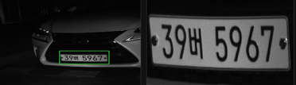 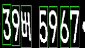</p>

## 목차
1. [프로젝트 목적](#1-프로젝트-목적)
2. [주요 성과](#2-주요-성과)
3. [시스템 구성](#3-시스템-구성)
4. [핵심 기법 ①: MAX-MIN Fuzzy 대비 강화](#4-핵심-기법--max-min-fuzzy-대비-강화)
5. [핵심 기법 ②: Hopfield Network 인식](#5-핵심-기법--hopfield-network-인식)
6. [실행 방법](#6-실행-방법)
7. [결과 및 오류 분석](#7-결과-및-오류-분석)
8. [트러블슈팅](#8-트러블슈팅)
9. [개선 계획](#9-개선-계획)

---

## 1. 프로젝트 목적

야간 번호판 영상은 헤드라이트 반사, 빛번짐(halation), 낮은 대비 때문에 글자 획이 끊기고 배경 노이즈가 커집니다. 균일한 조명을 전제로 한 전역 임계값 이진화로는 이런 영상을 처리하기 어렵습니다.

이 프로젝트는 두 가지를 목표로 합니다.
- **퍼지 논리 기반 대비 확장**으로 저조도 번호판의 글자 가시성을 높이기
- **연상 기억 신경망(Hopfield Network)**으로 손상된 글자 패턴을 원래 형태로 복원해 인식하기

역전파 학습 없이 행렬 연산만으로 동작하는 경량 파이프라인이라, 전처리 단계별로 성능에 미치는 영향을 분리해 분석할 수 있습니다.

## 2. 주요 성과

| 지표 | 결과 |
| --- | --- |
| 직접 정제한 야간 번호판 데이터 | 2,165장 |
| 번호판 영역 검출 (YOLOv8) | 20/20장 |
| 20% 노이즈 입력 클래스 인식률 (recall → classify) | Train 89.2% / Valid 93.4% |
| 비트 복원 정확도 | Train 95.6% / Valid 95.7% |
| 실제 야간 테스트 문자 정확도 | **62% (87/140자)** |

## 3. 시스템 구성

```
입력 영상
  → ① YOLOv8 번호판 검출
  → ② Hough Line 기울기 보정 (Deskew)
  → ③ MAX-MIN Fuzzy 스트레칭 + CLAHE
  → ④ 조도 구간별 적응형 이진화 + 모폴로지
  → ⑤ 연결 컴포넌트 노이즈 제거 + 한글 고정 Zone 글자 분리 + DI 필터
  → ⑥ 32×32 양극화(+1/−1) 정규화
  → ⑦ Hopfield 비동기 복원 → 코사인 유사도 분류
  → 인식 결과
```

| 단계 | 처리 | 설계 이유 |
| --- | --- | --- |
| 검출 | YOLOv8n fine-tuning | Anchor-free 헤드로 다양한 종횡비의 번호판을 탐지 |
| 기울기 보정 | Canny → Probabilistic Hough → 수평선 각도 **중앙값**으로 Affine 회전 | 테두리·에지 노이즈에 의한 오검출 각도에 강인 |
| 대비 강화 | Fuzzy 스트레칭 → CLAHE(clip 2.0, 4×4) | 전역 대비를 먼저 확보한 뒤 지역 빛번짐 보정 |
| 이진화 | 번호판 **중앙 50%** 밝기 중앙값으로 blockSize·C 자동 선택 | 볼트·테두리를 빼고 실제 조도만 측정 |
| 글자 분리 | 규격 기반 한글 Zone(2/7~3/7) + DI(Direction Index) 박스 필터 | 야간에 글자 간격이 뭉개져도 한글 위치를 안정적으로 추정 |
| 정규화 | 26×26 리사이즈 후 32×32 캔버스, ±1 인코딩 | 1,024 뉴런으로 연산량과 저장 용량의 균형 |

<p align="center">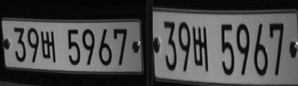</p>
<p align="center">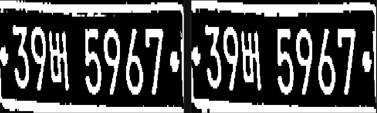<br><sub>이진화 직후(좌) / CLOSE-OPEN-CLOSE 모폴로지 적용 후(우)</sub></p>

## 4. 핵심 기법 ①: MAX-MIN Fuzzy 대비 강화

픽셀 밝기 x를 **Dark · Mid · Bright** 세 개의 사다리꼴 소속도 함수에 대입하고, 클래스별로 선형 스트레칭한 뒤 소속도를 가중치로 합산합니다.

| 클래스 | (a, b, c, d) | 담당 구간 |
| --- | --- | --- |
| Dark | (0, 10, 60, 110) | 야간·역광의 어두운 픽셀 |
| Mid | (60, 80, 160, 180) | 중간 밝기 |
| Bright | (130, 160, 230, 245) | 반사광·밝은 픽셀 |

```
S(x) = ( μD·sD(x) + μM·sM(x) + μB·sB(x) ) / ( μD + μM + μB + ε )
```

- 클래스 구간이 서로 겹치도록 설계해, 경계 밝기의 픽셀은 두 클래스의 결과가 부드럽게 섞입니다.
- 분모의 ε(1e-6)으로 모든 소속도가 0인 경우의 0 나눗셈을 방지합니다.

<p align="center">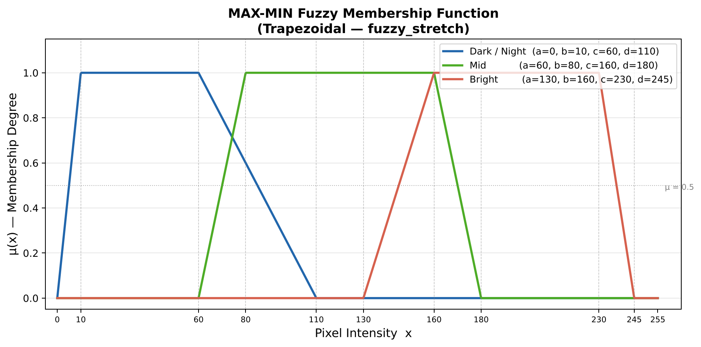</p>

## 5. 핵심 기법 ②: Hopfield Network 인식

Hopfield Network는 패턴을 가중치 행렬에 저장하고, 노이즈가 섞인 입력을 에너지가 가장 낮은 저장 패턴으로 수렴시키는 연상 기억 신경망입니다. NumPy로 직접 구현했습니다.

| 설계 결정 | 이유 |
| --- | --- |
| 숫자·한글 **네트워크 분리** (숫자 10클래스 20패턴 / 한글 36클래스 70패턴) | 획 구조가 다른 두 종류를 함께 저장하면 패턴 간 간섭(cross-talk)이 커짐 |
| **Pseudo-inverse** 학습 규칙 `W = Xᵀ(XXᵀ)⁻¹X` | Hebbian의 안정 용량(n=1024일 때 약 73개)에 한글 70패턴이 근접. Pseudo-inverse는 저장 패턴이 고정점이 됨을 보장 |
| **K-Means medoid**로 클래스당 대표 패턴 2개 | 평균 패턴은 연속값이 되어 ±1 구조가 깨짐. 이상치 20%를 제거한 뒤 실제 샘플을 대표로 사용 |
| **비동기 갱신** (최대 50 스윕) | 동기식은 2-사이클 진동이 생길 수 있음. 비동기식은 에너지 단조 감소 보장 |
| 코사인 유사도 분류 + 획 구조 Tie-break | 1·2위 margin이 작을 때 좌우·상하 픽셀 밀도로 ㅏ/ㅓ, ㅗ/ㅜ, 5/6/8 보정 |

<p align="center">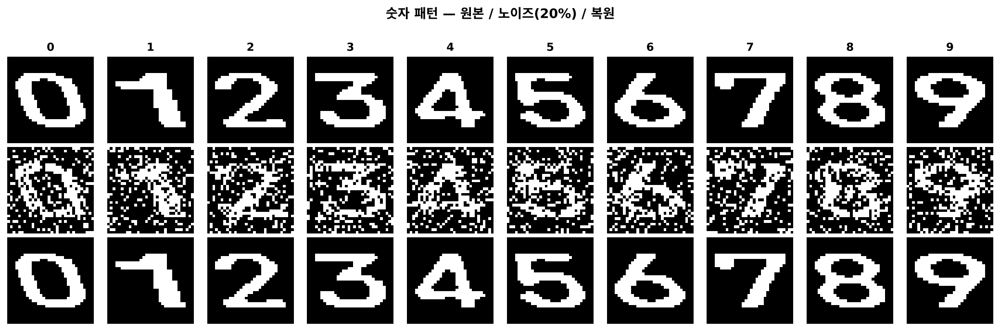 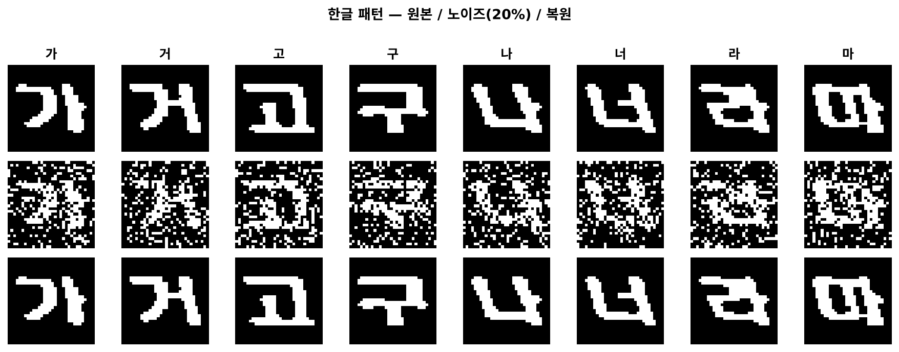<br><sub>원본 / 20% 노이즈 / Hopfield 복원 결과</sub></p>

## 6. 실행 방법

```bash
git clone https://github.com/pshcom/night-fuzzy-hopfield-plate-recognition.git
cd night-fuzzy-hopfield-plate-recognition
pip install -r requirements.txt
```

**바로 실행해 보기** (학습된 가중치와 샘플 사진이 포함되어 있어 clone 후 바로 동작합니다)
```bash
python run.py sample/83보1804.jpg
```
결과 이미지는 `sample/result_83보1804.jpg.png`로 저장됩니다.

**처음부터 재학습** (데이터셋 필요)
```bash
# 1) 전처리: trainplate/, validplate/ → prep_train/, prep_valid/ (글자별 32×32 ±1 패턴 저장)
python batch_preprocess.py

# 2) 학습·평가: 홉필드 가중치 생성 + 성능 요약 + 혼동 행렬 → hopfield_final/
python hopfield_final.py

# 3) testplate/ 전체 일괄 추론
python run_batch.py
```

- 학습·테스트 데이터셋(야간 번호판 2,165장)은 차량번호 개인정보 보호를 위해 공개하지 않습니다. 재학습하려면 `trainplate/`, `validplate/`에 `*_번호.jpg` 형식(예: `img001_12가3456.jpg`)으로 이미지를 넣어주세요.
- 결과 재현을 위해 난수 시드를 고정했습니다.
- 시각화 폰트는 Windows 기본 폰트(Malgun Gothic)를 사용합니다.

### 폴더 구조
```
├── preprocessing_core.py        # 학습용 전처리 (2단계 이진화, DI<6)
├── infer_preprocessing.py       # 추론용 전처리 (5단계 이진화, 볼트·테두리 필터, fallback 이진화, DI<4)
├── batch_preprocess.py          # 학습/검증 이미지 일괄 전처리
├── hopfield_network.py          # Hopfield: medoid 추출, Pseudo-inverse 학습, 비동기 복원, 분류
├── hopfield_final.py            # 학습 + Train/Valid 평가 + 혼동 행렬
├── run.py                       # 단일 이미지 추론·시각화
├── run_batch.py                 # 일괄 추론
├── license_plate_detector.pt    # YOLOv8 번호판 검출 가중치
├── hopfield_final/              # 학습된 홉필드 가중치(.npy), summary.txt, 결과 그래프
├── sample/                      # 테스트용 야간 번호판 샘플 4장
├── requirements.txt
└── docs/images/                 # README 이미지
```

## 7. 결과 및 오류 분석

직접 촬영한 야간 번호판 20장(총 140자)에서 **87자 정확 인식(62%)**을 기록했습니다.

| 성공: `83보1804` → `83보1804` | 실패: `11더7020` → `24소024` |
| --- | --- |
| 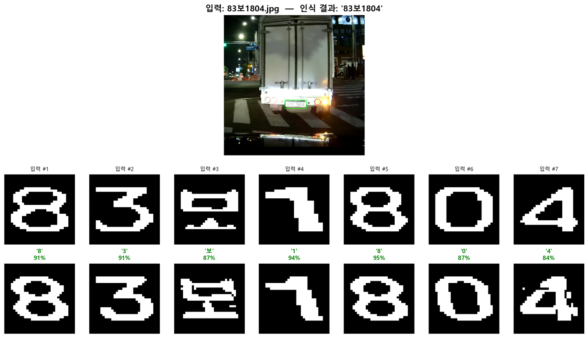 | 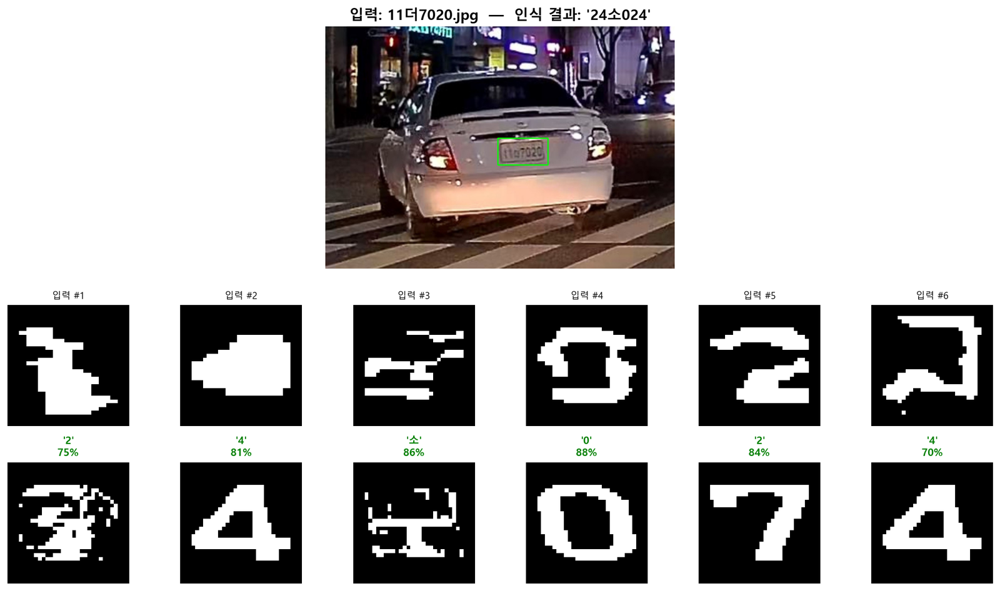 |

<p align="center">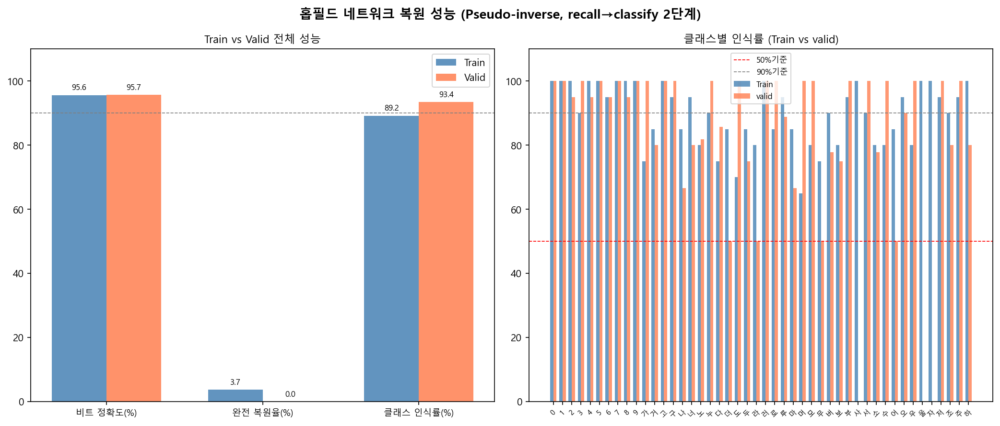<br><sub>Train vs Valid 성능 및 클래스별 인식률</sub></p>
<p align="center">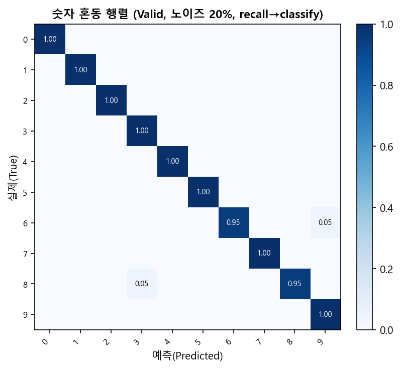 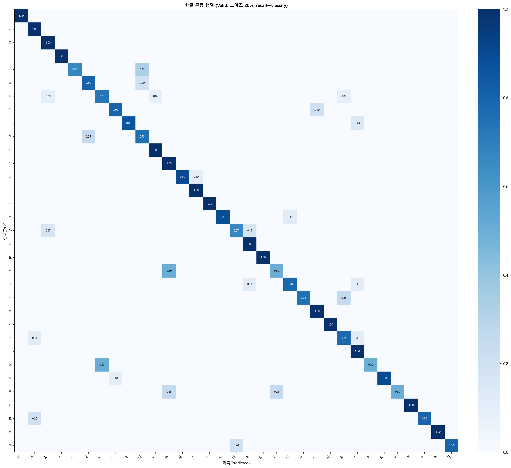<br><sub>숫자 혼동 행렬(Valid: 6→9, 8→3 각 5% 외 100%) / 한글 혼동 행렬</sub></p>

**실패 원인 분류**
- **역광·극한 야간**: 이진화 후 획 자체가 소실되어 입력 패턴이 손상됨
- **Spurious attractor**: 저장하지 않은 가짜 안정 상태로 수렴 (예: 8→9, 6→3)
- **구형 번호판**: 중앙 하이픈 레이아웃을 학습하지 않아 글자 분리가 어긋남
- **유사 글자**: 획이 끊기면서 '조'를 '라'로 혼동

## 8. 트러블슈팅

### ① 복원율은 낮은데 무엇을 개선해야 할지 판단이 안 됨
- **문제**: medoid 패턴만 저장했을 때 20% 노이즈 입력의 완전복원율(1,024비트 전부 일치)이 20~25%에 그쳤습니다.
- **원인 분석**: 비동기 갱신의 무작위 순서와 20% 노이즈가 겹치면 1,024비트를 모두 맞추기가 매우 어렵습니다. 게다가 기존 평가 코드는 노이즈 입력을 recall 없이 바로 분류해, 실제로는 홉필드의 복원 성능을 재고 있지 않았습니다.
- **해결**: 평가를 recall → classify 2단계로 고치고, 비트 정확도 · 완전복원율 · 클래스 인식률 세 지표로 분리해 측정했습니다. 끌림 영역을 넓히려는 노이즈 증강(5% 비트 반전) 학습도 구현해 비교했고, 최종 모델은 증강 없이(`augment=False`) 확정했습니다.
- **결과**: 완전복원율은 낮아도(Train 3.7%) 복원 패턴이 올바른 클래스로 분류된다는 것을 확인했습니다. 최종 클래스 인식률 Train 89.2% / Valid 93.4%, 비트 정확도 95.6% / 95.7%.

### ② 한글 자모 분해 학습 실험
- **문제**: 한글 클래스의 혼동이 숫자보다 컸습니다 (36클래스, 획 구조가 비슷한 글자 다수).
- **시도**: 자음·모음을 따로 학습하는 자모 분해 방식을 별도로 구현해 비교했습니다.
- **결과**: 기존 완성형 학습보다 성능이 낮아, 비교 결과를 근거로 완성형 방식을 유지했습니다.

### ③ 테스트 이미지에만 맞춘 규칙 걷어내기
- **문제**: 이진화 분기를 7단계로 늘리고 특정 글자 쌍 보정 규칙을 넣자 테스트 정확도가 70.0%(98/140자)까지 올랐습니다.
- **원인**: 발표 피드백에서 이 규칙들이 보유한 테스트 이미지에 과하게 맞춰져 있어, 새로운 도로 영상에서는 일반화되기 어렵다는 지적을 받았습니다.
- **해결**: 해당 규칙을 제거하고 전처리 코드를 롤백해, 조도 구간 근거가 있는 분기만 남겼습니다.
- **결과**: 수치는 62%(87/140자)로 낮아졌지만, 숫자를 올리는 것보다 재현 가능한 성능을 우선하는 기준을 세웠습니다.

## 9. 개선 계획
- 구형 번호판(하이픈 포함)을 포함한 학습 데이터 확충
- 원거리 소형 번호판을 위한 초해상화(Super-Resolution) 전처리 추가
- 도로 주행 블랙박스 영상으로 별도 검증셋 구성

## 참고문헌
- J. J. Hopfield, "Neural networks and physical systems with emergent collective computational abilities," *PNAS*, 1982.
- D. Bradley and G. Roth, "Adaptive thresholding using the integral image," *J. Graphics Tools*, 2007.
- S. Du et al., "Automatic license plate recognition (ALPR): A state-of-the-art review," *IEEE TCSVT*, 2013.
